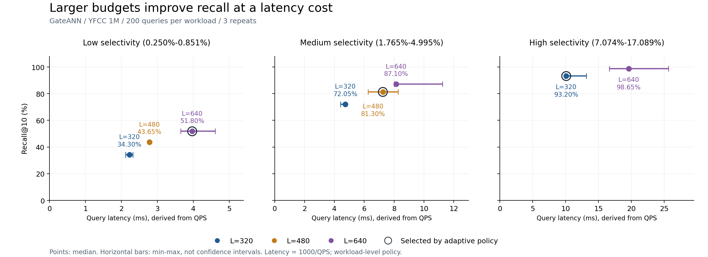

# 基于 SSD 的过滤向量检索系统实验与性能分析

Computer Systems Design Course Lab

## 1. 项目简介

本项目基于课程提供的实验框架，对两种 SSD 驻留式过滤向量检索系统 **PipeANN-Filter** 和 **GateANN** 进行部署、功能验证及性能评估。

实验采用 YFCC 百万规模向量数据集，在不同过滤选择率（Selectivity）和搜索参数（L）下，分析两个系统的检索准确率、查询延迟、吞吐量、逻辑 I/O 开销及资源占用情况。

本仓库在原始课程项目的基础上，增加了正式实验结果、环境记录和 GateANN 兼容性修复补丁，并实现了选择率感知的负载级搜索预算调度，完成补充对照实验与成本分析。

## 2. 与原始课程仓库的区别

本仓库保留原始课程框架，主要新增内容如下：

| 内容 | 本仓库完成的工作 |
|---|---|
| 实验环境 | 在 VMware Ubuntu 虚拟机中搭建并验证运行环境 |
| 系统部署 | 完成 PipeANN 和 GateANN 的构建与运行 |
| 功能验证 | 在 Debug 数据集上验证两个系统的检索正确性 |
| 正式实验 | 在百万规模 YFCC 数据集上运行对比实验 |
| 性能分析 | 比较 Recall@10、Latency、QPS 和逻辑 I/O |
| 兼容性修复 | 保存 GateANN Linux AIO 相关源码补丁 |
| 实验材料 | 新增正式实验结果 CSV 和环境信息 |
| 优化实现与验证 | 实现负载级 Selectivity-aware 预算选择，完成8个配置×3次补充实验并分析准确率与成本 |

**说明：** 本项目的主要工作是实验复现、系统对比及性能分析，不声称重新实现 PipeANN 或 GateANN 的核心搜索算法。

## 3. 实验环境

| 项目 | 配置 |
|---|---|
| 虚拟化平台 | VMware |
| 操作系统 | Ubuntu 22.04.5 LTS |
| Linux Kernel | 6.8.0-138-generic |
| CPU | AMD Ryzen 7 6800H，分配 4 vCPU |
| 内存 | 约 7.7 GiB |
| 编译器 | GCC/G++ 11.4.0 |
| I/O 后端 | Linux AIO |
| 数据集 | YFCC，1M × 192D，uint8 |

完整环境记录见 `experiments/20261004-173150/environment.txt`。

## 4. 实验设计

### 4.1 数据集与过滤负载

正式实验使用 100 万条、192 维的 YFCC 向量数据，通过真实标签构造不同过滤选择率的查询负载。

| 工作负载 | Selectivity 范围 |
|---|---|
| Low | 0.250%–0.851% |
| Medium | 1.765%–4.995% |
| High | 7.074%–17.089% |

每组工作负载包含 200 条查询。

### 4.2 搜索参数

主要实验参数：

- Top-K：10
- 查询线程数：1
- Beamwidth：8
- 每组配置重复次数：3
- PipeANN：L = 20、40、80（High）；其他负载采用 L = 40
- GateANN：L = 160、320、640（High）；其他负载采用 L = 320

由于两套系统对搜索参数 L 的实现和工作量定义不同，不直接将相同 L 数值作为公平性能比较依据，而是重点比较相近 Recall 水平下的延迟与 I/O 开销。

## 5. 实验结果

### 5.1 High Selectivity 下的性能比较

以下数据为三次运行结果的中位数。

| 系统 | L | Recall@10 | 平均延迟 | 平均逻辑 I/O |
|---|---:|---:|---:|---:|
| PipeANN | 20 | 79.80% | 7.159 ms | 79.30 |
| PipeANN | 40 | 92.00% | 10.187 ms | 123.30 |
| PipeANN | 80 | 97.20% | 16.616 ms | 212.50 |
| GateANN | 160 | 81.30% | 4.630 ms | 24.62 |
| GateANN | 320 | 93.20% | 8.696 ms | 46.71 |
| GateANN | 640 | 98.65% | 14.925 ms | 88.89 |

在相近 Recall 水平下，GateANN 在本次实验中表现出更低的查询延迟和报告的逻辑 I/O 数量。

需要注意，不同系统的内部 I/O 统计口径可能存在差异，不能直接将逻辑 I/O 差异等同于物理磁盘访问量差异。

### 5.2 不同 Selectivity 下的性能

采用代表性配置 PipeANN L=40、GateANN L=320。

| 系统 | Selectivity | Recall@10 | 延迟 |
|---|---|---:|---:|
| PipeANN | Low | 98.60% | 5.719 ms |
| PipeANN | Medium | 90.80% | 13.725 ms |
| PipeANN | High | 92.00% | 10.187 ms |
| GateANN | Low | 34.30% | 1.828 ms |
| GateANN | Medium | 72.05% | 3.759 ms |
| GateANN | High | 93.20% | 8.696 ms |

在本次固定搜索预算设置下，GateANN 在强过滤条件下出现明显的 Recall 下降，而 PipeANN 保持了较高的检索准确率。

不同 Selectivity 负载由不同真实标签构成，因此结果也可能受到标签分布和查询难度影响，不能完全归因于选择率变化。

完整结果见 `experiments/20261004-173150/results.csv`。

## 6. GateANN Linux AIO 兼容性修复

在课程实验环境中，GateANN 的 Linux AIO 相关代码应用了一处兼容性补丁：

原始代码：

`cb.data = (void *) &reqs[j];`

修复后：

`cb[j].data = (void *) &reqs[j];`

修复内容是为当前 I/O 请求设置对应控制块的用户数据指针，不涉及 GateANN 核心搜索算法的修改。

补丁保存在：

`patches/gateann-aio-compat.patch`

该补丁可用于在对应的 GateANN 源码版本上重现本次兼容性修改。

## 7. 实验复现

本项目使用课程提供的运行脚本。

主要流程如下：

1. 准备 Ubuntu 编译与运行环境。
2. 获取课程提供的 YFCC 数据集及预构建索引。
3. 执行 `bash scripts/check_dataset.sh` 检查数据集。
4. 执行 `bash scripts/prepare_pipeann.sh` 和 `bash scripts/prepare_gateann.sh` 准备两个系统。
5. 执行 `bash scripts/run_debug_validation.sh` 验证功能正确性。
6. 执行 `bash scripts/check_indexes.sh` 检查正式实验索引。
7. 执行 `bash scripts/run_formal_experiments.sh` 运行正式实验。

大型数据集、预构建索引、编译产物及运行时目录未包含在本仓库中，需要按照课程原始说明另行准备。

<a id="gateann-budget-experiment"></a>

## 8. GateANN 选择率感知预算优化实验

**状态：已实现负载级预算选择，并完成24次补充测量。** 该实现复用课程适配器，在每档查询前选择 L；尚未修改 GateANN 内核以实现逐查询自适应。

### 8.1 策略与代码

令 s 为过滤选择率（比例值），采用以下预设候选规则：

| 条件 | L | 本次对应负载 |
|---|---:|---|
| s < 0.01 | 640 | Low |
| 0.01 ≤ s < 0.05 | 480 | Medium |
| s ≥ 0.05 | 320 | High |

策略实现见 [adaptive_budget.py](optimization/adaptive_budget.py)，运行与核验见 [experiment.py](optimization/experiment.py)。运行前检查负载内所有选择率是否处于同一分段；跨阈值时停止。本规则与预算值尚未被证明最优。

### 8.2 实验设置

YFCC 1M×192D uint8，每档200条查询；threads=1、beamwidth=8、K=10、mem_L=0、cache_budget=0、full_adj_neighbors=32，AIO后端。Low和Medium分别测试L=320/480/640，High测试320/640，共8个配置，每个重复3次。三种策略引用同批观测，避免重复跑基线。

下表使用本轮三次运行的中位数；括号内为相对同期固定320的Recall增量。第5节保留原正式实验，其延迟不与本轮混用。

| 负载 | adaptive L | Recall 固定320 → adaptive | 延迟 ms 固定320 → adaptive | 逻辑 I/O 固定320 → adaptive |
|---|---:|---|---|---|
| Low | 640 | 34.30% → 51.80%（+17.50个百分点） | 2.222 → 3.968 | 4.38 → 7.72 |
| Medium | 480 | 72.05% → 81.30%（+9.25个百分点） | 4.739 → 7.246 | 16.75 → 24.36 |
| High | 320 | 93.20% → 93.20%（共享同组观测） | 10.101 → 10.101 | 46.69 → 46.69 |

### 8.3 准确率与成本的折中

以下是三档各200查询的**离线合成**，不是实际交错混合查询流测试。每个repeat先合成，再取三次中位数；QPS按总查询数除以总查询时间计算。

| 策略 | Recall@10 | 延迟 (ms) | QPS | 逻辑 I/O/查询 |
|---|---:|---:|---:|---:|
| 固定320 | 66.52% | 5.621 | 177.91 | 22.61 |
| adaptive 640/480/320 | 75.43% | 7.338 | 136.27 | 26.26 |
| 固定640 | 79.18% | 11.817 | 84.62 | 42.85 |

相对固定320，adaptive 的Recall增加8.92个百分点，延迟增加30.56%；相对固定640，延迟降低37.90%、逻辑I/O降低38.72%，但Recall低3.75个百分点。因此，本次验证支持准确率与开销的折中，不构成全面提速或最优策略的证明。Low在L=640下Recall仍只有51.80%，强过滤问题尚未解决。

延迟为课程适配器依据查询阶段QPS计算的1000/QPS，不含进程加载总耗时，也不是P99。逻辑I/O不是物理磁盘读取次数。三次运行波动不可忽略；尚未比较完整的固定480方案，也未测量逐查询预算选择的在线开销。



图中点为中位数，横线为min–max；各子图横轴范围不同。完整8组结果、波动范围和局限见[补充实验说明](docs/gateann-budget-results.md)。

### 8.4 复现与结果

在数据、索引和GateANN已准备的课程仓库根目录执行：

```bash
python3 optimization/experiment.py check
bash scripts/optimization/run_budget_sweep.sh
```

已有结果只需运行 `python3 optimization/experiment.py analyze --experiment-dir course_runs/optimization/<实验ID>`，无需重复查询。环境、缓存要求和完整操作见 [START_HERE](optimization/START_HERE.md)。

本次实验ID：`budget-20261110-143518-ec7e5e19`。已核对24次运行与72个原始文件哈希，证据包含：

- [原始测量汇总](experiments/optimization/budget-20261110-143518-ec7e5e19/measurements.csv)
- [预算扫描 median/min/max/range](experiments/optimization/budget-20261110-143518-ec7e5e19/sweep_summary.csv)
- [三策略 median/min/max/range](experiments/optimization/budget-20261110-143518-ec7e5e19/strategy_summary.csv)
- [运行 manifest](experiments/optimization/budget-20261110-143518-ec7e5e19/manifest.json)与[归档文件索引](experiments/optimization/budget-20261110-143518-ec7e5e19/ARTIFACTS.json)

数据集、索引、编译产物和第三方系统源码不包含在该证据目录中。

## 9. 仓库结构

- `adapters/`：实验系统适配代码
- `config/`：实验配置
- `datasets/`：数据集相关配置与工具
- `docs/`：课程文档与实验说明
- `scripts/`：系统准备、验证和实验运行脚本
- `tests/`：测试代码
- `experiments/20261004-173150/`：本次正式实验结果及环境记录
- `patches/`：GateANN Linux AIO 兼容性补丁
- `optimization/` 与 `scripts/optimization/`：预算策略、运行器与测试
- `docs/gateann-budget-results.md`：补充实验说明
- `experiments/optimization/budget-20261110-143518-ec7e5e19/`：优化实验结果、manifest与原始日志

PipeANN 与 GateANN 的完整上游源码位于本地实验环境的 `systems/` 目录中，该目录未作为本仓库的普通 Git 文件提交。

## 10. 项目来源与说明

本项目基于课程提供的 [fvs-course-lab](https://gitee.com/wei-fangyu/fvs-course-lab) 实验框架。

PipeANN 与 GateANN 为已有研究系统。本仓库中的原始课程代码及相关第三方代码，其版权和许可归各自权利人所有。

本仓库旨在记录课程实验复现过程、性能评估结果和实验分析工作。
