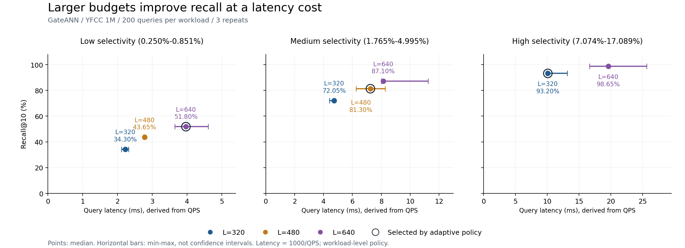

# 5 选择率感知搜索预算优化与补充实验

针对 GateANN 在强过滤负载下 Recall@10 较低的现象，本实验实现了基于过滤选择率的负载级搜索预算选择，并完成补充对照实验。结果表明，增大 Low 和 Medium 的搜索预算能够提高 Recall，但会增加查询延迟和逻辑 I/O。预设分档策略体现了准确率与开销之间的折中，尚不能证明其为最优预算配置。

## 5.1 观察现象 Observation

原正式实验中，GateANN 使用固定 L=320 时，Low、Medium、High 的 Recall@10 分别为34.30%、72.05%和93.20%。Low 档选择率约为0.250%–0.851%，其检索准确率明显低于 High 档。由于不同档位采用不同真实标签，档位之间还包含标签分布和查询难度差异，不能把所有差异完全归因于选择率。

本次补充实验固定同一档位的数据、查询和索引，只改变 L，检验增加搜索预算能否改善该档位的 Recall。优化收益以本轮同期 L=320 的观测为基线，不与原正式实验的延迟混合计算。

## 5.2 机制解释 Mechanism

本实验通过课程适配器将 L 传入 GateANN 的查询程序，控制查询所使用的搜索预算。提出该方案时的机制假设是：强过滤条件下，较小预算可能限制有效候选的探索，增加预算有机会找到更多符合过滤条件的近邻。补充实验中 Recall 和逻辑 I/O 随 L 增长的结果与这一解释一致。

上述解释是根据参数变化与测量结果作出的推断。本次没有采集逐节点遍历轨迹，不能据此证明 Recall 损失完全由预算不足引起，也不能把策略效果归因于某一个内部搜索步骤。

## 5.3 瓶颈判断 Bottleneck

Low 在 L 从320增大到640后，Recall 从34.30%升至51.80%，说明增加搜索预算能够缓解部分准确率损失。但51.80%的 Recall 仍较低，因此单纯增大 L 尚未解决强过滤条件下的检索问题。图结构、过滤后的候选可达性及标签分布是否进一步限制结果质量，仍需额外实验验证。

## 5.4 优化实现 Optimization

令 s 为满足过滤条件的向量数占全部向量数的比例，取值范围为0至1。采用以下预设规则：

| 选择率条件 | 选择的 L |
|---|---:|
| s < 0.01 | 640 |
| 0.01 ≤ s < 0.05 | 480 |
| s ≥ 0.05 | 320 |

策略函数位于 `optimization/adaptive_budget.py`，调度、核验和统计位于 `optimization/experiment.py`。运行前读取负载的 `labels.csv`，检查所有选择率都落在同一个策略分段；若跨越阈值则停止，避免用一个代表值掩盖档内差异。本次 Low、Medium、High 分别选择640、480、320。

该实现属于 workload-level budget selection，即每档负载在启动查询前选择一次 L。它复用现有 GateANN 适配器，没有修改 GateANN 查询内核，也没有实现混合查询流中的逐查询预算选择。原 AIO 兼容性补丁属于运行兼容修复，与此预算策略是不同的工作。

## 5.5 预期收益与代价 Expected Benefit and Trade-off

预期收益是在 Low 和 Medium 提高 Recall，同时在 High 保持较小预算，以控制相对于统一 L=640 的开销。可能代价是更多候选探索引起的查询时间、CPU 工作量和逻辑 I/O 增加；本次主要测量查询性能和逻辑 I/O，没有单独量化策略的在线 CPU 开销或内存增量。

实测中，Low 与 Medium 的 Recall 分别增加17.50和9.25个百分点，同时延迟中位数分别增加78.57%和52.90%，逻辑 I/O 分别增加76.26%和45.43%。因此，该策略的收益是以更多查询开销换取更高准确率，不能表述为相对固定320的全面性能提升。

## 5.6 验证方法与补充实验 Validation Plan

补充实验使用相同的 YFCC 1M×192D uint8 数据、预构建索引和查询集，每档200条查询，控制参数为 threads=1、beamwidth=8、K=10、mem_L=0、cache_budget=0、full_adj_neighbors=32，采用 AIO 后端和 Release 构建。

Low、Medium 分别测试 L=320、480、640，High 测试320、640，共8个配置，每个重复3次，得到24次测量、4800条计入统计的查询。每次只运行一个 L，按固定随机种子在每轮内打乱配置顺序。固定320、固定640和 adaptive 复用这批观测，不重复执行相同基线。原始输出、运行命令和输入文件哈希通过 manifest 保存。

统计使用三次运行的中位数及 min、max、range。GateANN 适配器将查询阶段的 QPS 换算为延迟，延迟毫秒数等于1000除以 QPS；该值不是包含索引加载的进程总耗时，也不是独立测量的逐查询尾延迟。逻辑 I/O 表示系统内部请求计数，不等同于物理磁盘读取次数。原始 QPS 按整数打印，换算小数不代表新增计时精度。

运行不清空操作系统页缓存。测量前确认邻接缓存存在，并对输入做哈希核验，因此本次不是冷缓存实验。实验在同一虚拟机内执行，但未单独记录全部宿主后台活动，延迟波动需要结合范围解释。

### 5.6.1 搜索预算扫描结果

表5-1给出各配置三次运行的中位数。方括号为最小值和最大值，不是置信区间；所有 Recall 在打印精度下三次一致。完整四项指标的范围见归档 CSV。

| 负载 | L | Recall@10 (%) | 延迟 ms [min, max] | QPS | 逻辑 I/O/查询 |
|---|---:|---:|---|---:|---:|
| Low | 320 | 34.30 | 2.222 [2.114, 2.320] | 450 | 4.38 |
| Low | 480 | 43.65 | 2.778 [2.747, 2.793] | 360 | 6.04 |
| Low | 640 | 51.80 | 3.968 [3.650, 4.608] | 252 | 7.72 |
| Medium | 320 | 72.05 | 4.739 [4.405, 4.762] | 211 | 16.75 |
| Medium | 480 | 81.30 | 7.246 [6.250, 8.264] | 138 | 24.36 |
| Medium | 640 | 87.10 | 8.130 [8.000, 11.236] | 123 | 31.93 |
| High | 320 | 93.20 | 10.101 [9.901, 13.158] | 99 | 46.69 |
| High | 640 | 98.65 | 19.608 [16.667, 25.641] | 51 | 88.89 |



图5-1中点表示中位数，横向误差线表示三次运行的最小值至最大值，外圈标记为 adaptive 选取的预算。各子图横轴范围不同，应读取坐标值进行比较。

Low 的三个预算对应 Recall 为34.30%、43.65%和51.80%，增加预算持续提高准确率，但查询成本同时上升。Medium 的 L=480 达到81.30%，L=640进一步达到87.10%，因此480体现的是成本折中，不能称为准确率最优。High 从320增大到640时，Recall 增加5.45个百分点，延迟中位数由10.101 ms增加至19.608 ms，逻辑 I/O由46.69增加至88.89。

### 5.6.2 三种策略比较

表5-2以三档各200条查询作等查询数离线合成，不代表实际交错混合查询流运行。先在每个 repeat 内合成，再对三次结果求中位数。Recall、延迟和 I/O按查询数加权；混合 QPS等于总查询数除以各档查询时间之和，不能对 QPS直接求算术平均。

| 策略 | Low / Medium / High 的 L | Recall@10 (%) | 延迟 (ms) | QPS | 逻辑 I/O/查询 |
|---|---|---:|---:|---:|---:|
| 固定320 | 320 / 320 / 320 | 66.52 | 5.621 | 177.91 | 22.61 |
| 分档 adaptive | 640 / 480 / 320 | 75.43 | 7.338 | 136.27 | 26.26 |
| 固定640 | 640 / 640 / 640 | 79.18 | 11.817 | 84.62 | 42.85 |

与固定320相比，adaptive 的合成 Recall增加8.92个百分点，延迟增加30.56%，QPS下降23.40%，逻辑 I/O增加16.15%。与固定640相比，adaptive 的延迟降低37.90%，逻辑 I/O降低38.72%，但 Recall低3.75个百分点。结果支持其作为准确率与成本之间的一种折中，不能据此宣称全面优于固定预算。

adaptive 的 Low 直接引用 Low/640，High直接引用 High/320；这些共享观测不能当作额外独立样本。High 相对固定320保持相同结果，是由预算和观测复用决定的。

## 5.7 结论与局限

本实验完成了选择率感知的负载级预算策略实现与补充验证，支持“增大 Low、Medium 的预算能够改善 Recall”这一假设，并量化了延迟与逻辑 I/O代价。当前规则和预算值尚未被证明最优。

结果存在四方面限制。第一，同一组200条查询重复三次，不能代表跨查询集、标签和数据集的稳定收益。第二，虚拟机延迟存在较大波动，例如 High/640 的延迟范围为16.667–25.641 ms，Medium/480与640的范围也有重叠，不能仅凭中位数作统计显著性判断。第三，未测试 High/480，因此没有完整比较统一固定480。第四，实现仍在负载层，尚未测量真实混合流下逐查询选择率估计和预算调度的在线开销。

本轮 L=320延迟与原正式实验不同，因此本章仅采用同期对照计算增减比例。Low在最大已测预算下 Recall仍为51.80%，说明该优化只缓解了部分准确率损失。后续若继续研究，应在独立查询集上验证，并按统一协议补充中间预算或真正的逐查询实现。

## 复现与证据定位

补充实验编号：`budget-20261110-143518-ec7e5e19`。用户课程提交：`efbdd460d48a60f2257999a29b5215b31612524a`；GateANN提交：`71e87cbf0e25c0400c0109dd25a64a7c4dccc9dd`。

主要执行命令：

```bash
python3 optimization/experiment.py check
bash scripts/optimization/run_budget_sweep.sh
```

已有结果通过 `python3 optimization/experiment.py analyze --experiment-dir course_runs/optimization/budget-20261110-143518-ec7e5e19` 核验，无需重跑查询。

归档见[实验记录目录](../experiments/optimization/budget-20261110-143518-ec7e5e19/)、[预算扫描汇总](../experiments/optimization/budget-20261110-143518-ec7e5e19/sweep_summary.csv)、[策略汇总](../experiments/optimization/budget-20261110-143518-ec7e5e19/strategy_summary.csv)和[原始输出索引](../experiments/optimization/budget-20261110-143518-ec7e5e19/ARTIFACTS.json)。已核验24个原始命令、72个输出文件哈希，并独立重算全部汇总表。数据、索引和二进制未纳入此证据包，原始返回邻居ID也未另行导出，因此没有在报告整理阶段独立重算邻居级 Recall。
